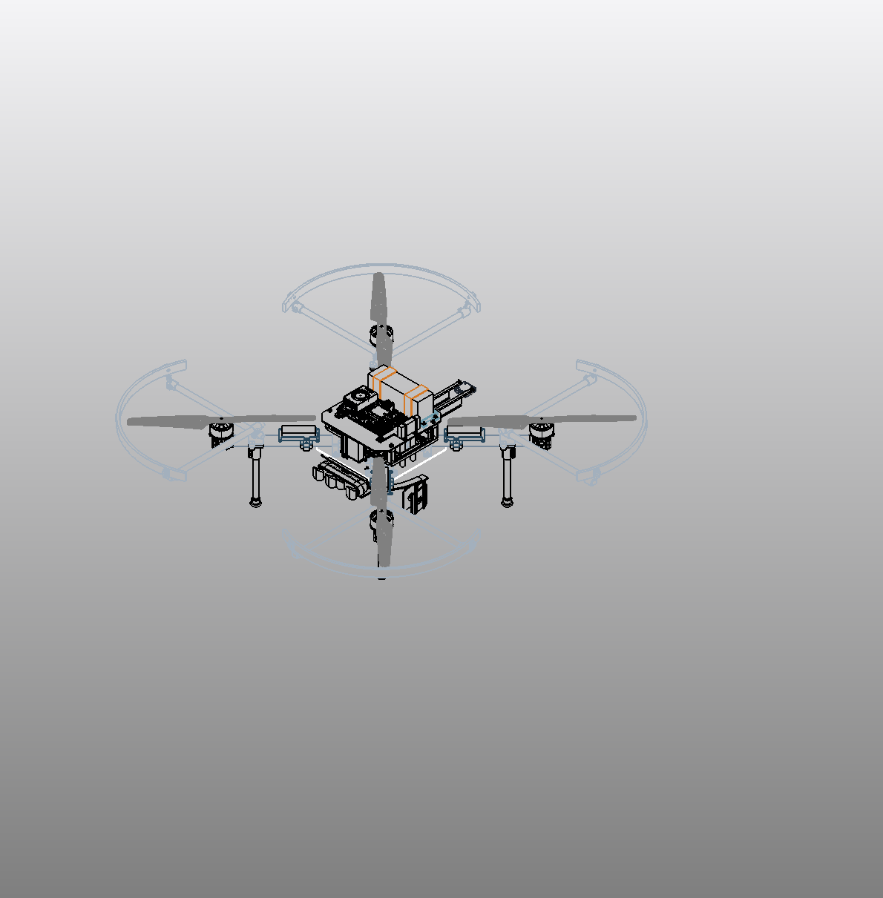
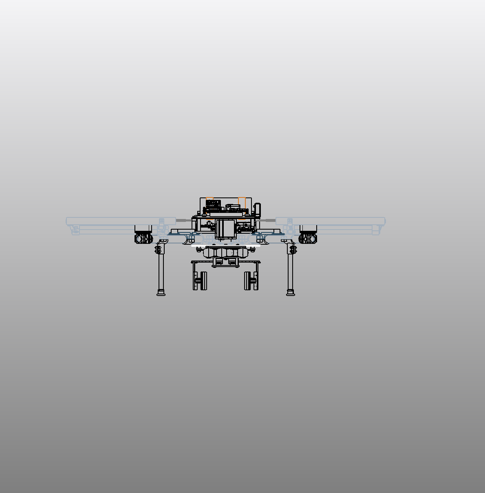
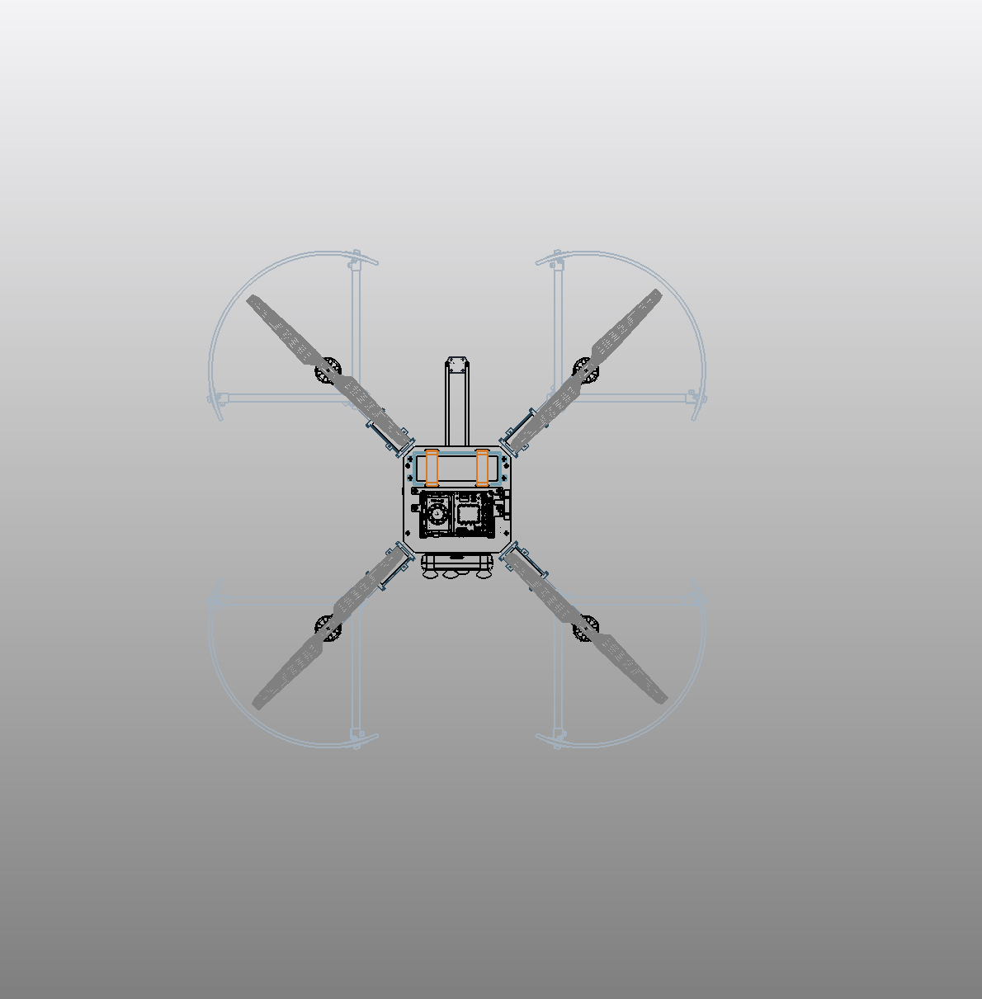
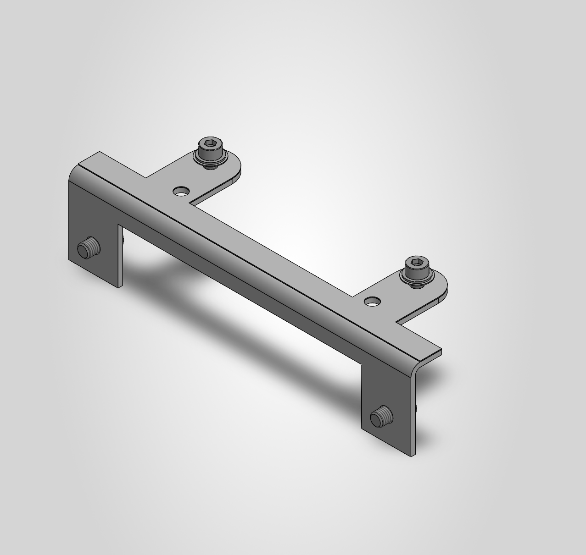

# C235 — camera mount and shelf retirement WIP

Current saved assembly: [DronePlayground.SLDASM](cad/DronePlayground/WORKING/R3_1/DronePlayground.SLDASM), configuration **R3_3_SHELF_REMOVAL_WIP**. The installed 16-piece D455 service mount replaces the previous camera supports while preserving the exact D455 pose. The obsolete external shelf and 14 old camera-support/hardware roots are suppressed only in this configuration. The prior C215 and C180 configurations remain preserved.

The new mount uses a service yoke, thin G10 interface pieces and native mounting hardware. A dedicated lower carbon-fiber plate hole configuration preserves the legacy plate configurations. The four checked camera-mount mates report zero errors; the C215/C180 root mates remain preserved. C235 reopened with 88 roots / 48 active roots and error/warning codes 0/0. This records scoped persistence and geometry checks, rather than all-state physical qualification.

The incomplete native represented mass is **3.194656 kg**, approximately **65.13 g lower than C215**. These values include assumed materials and incomplete representations; they are not reconciled aircraft mass, flight CG or demonstrated flight margin.

Physical service access, G10 locking, underhead contact, fastener preload, vibration and all-state behavior remain open. Inherited frame/CAM and remaining whole-aircraft integration and qualification holds persist. This is an engineering WIP archive, not a manufacturing or flight release. Native reference bytes are preserved; cross-machine reference resolution and cold portable checkout remain unverified.

The [16-file checkpoint manifest](checkpoints/C235/manifest.json) records relative paths, sizes and SHA256 hashes. The [current asset manifest](manifest.json) retains unchanged dependencies without duplicating CAD. Retrieve native files with Git LFS and `git lfs pull`. The [C215 baseline](https://github.com/rohanbhadange/RTX-AVC-Design/tree/d2333e64767bef0c173a161def651d16077cb0c1) and earlier checkpoints remain available in history.

## Saved native views

The C222 native detail shows the camera-mount module subsequently installed in this checkpoint.

