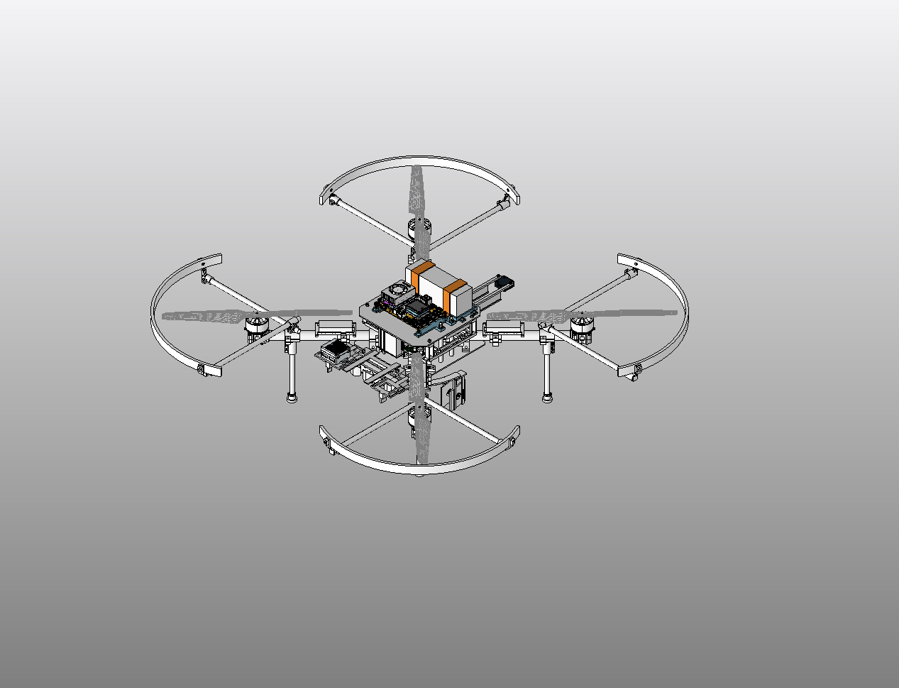
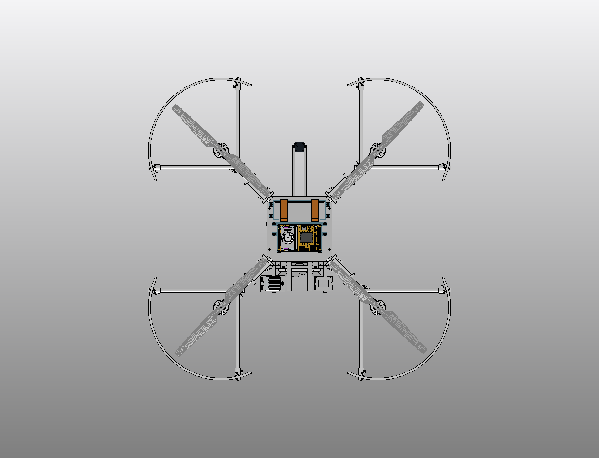
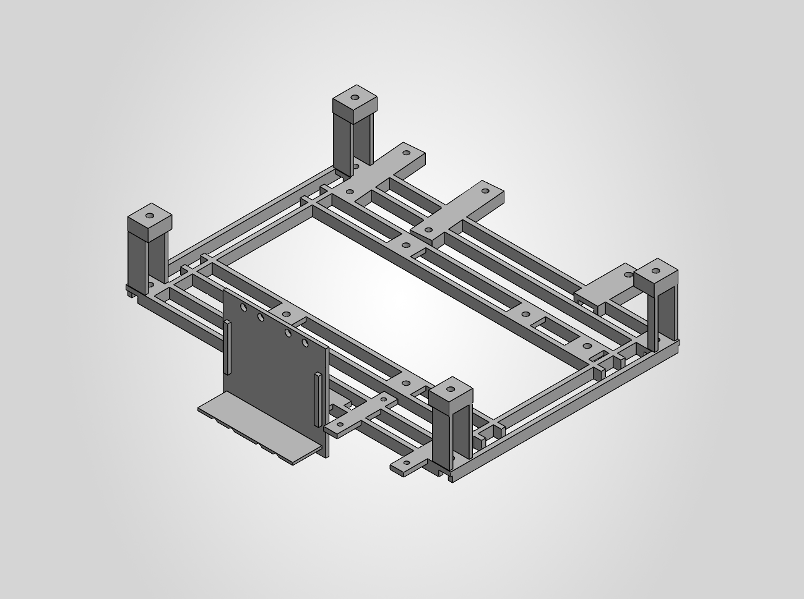

# C168 — integrated internal power carrier

Current saved assembly: [DronePlayground.SLDASM](cad/DronePlayground/WORKING/R3_1/DronePlayground.SLDASM), configuration **R3_3_PACKAGING**. C167 installed the integrated internal power carrier; C168 reopened the saved main and exported the native views below. The earlier `R3_2_POWER_CASSETTE_WIP` configuration is preserved.

The integrated support replaces the previous floor and four separate hangers while preserving electronics and PCB-hardware poses. Mounting pieces decrease from 80 to 72. The support change gives approximately **19 g of provisional density-equivalent mass reduction**; this is not a measured aircraft-weight saving. The installed carrier part retains its development filename ending in `Integrated_Carrier_Candidate02.SLDPRT`.

Scoped native checks covered a 120-body scene, 12 hardware checks and allocated upper driver-access paths. On reopen, the main had 83 roots / 62 active roots; the changed module had 24 roots / 22 active roots. The three new root mates reported zero errors. Save and reopen reported error/warning codes 0/0. These checks cover the changed support/module and current main root identities, references, configurations and poses; they are not an exhaustive nested-import or all-state release audit.

The inherited frame-reference warning and CAM lightweight-restoration warning remain engineering holds. Actual wiring, electrical interfaces, remaining electronics/sensor/radio integration, printing/material behavior and dynamic/load qualification remain unfinished. Native represented mass and CG remain incomplete physical-aircraft estimates. This prototype is not a manufacturing or flight release. Cross-machine reference resolution and cold portable checkout have not been verified.

The [six-file checkpoint manifest](checkpoints/C168/manifest.json) gives relative paths, sizes and SHA256 hashes. The [current asset manifest](manifest.json) also retains the unchanged baseline dependencies without duplicating them. CAD bytes and embedded reference paths are preserved and stored through Git LFS; use `git lfs pull` after cloning. The [C124 baseline](https://github.com/rohanbhadange/RTX-AVC-Design/tree/33064c5ab7eba07455f86873217466ac426707c5), its historical notes and its views remain available.

## Native checkpoint views

The C164 detail view below shows the integrated carrier geometry subsequently installed in C167; the filename records the earlier part-development checkpoint.

