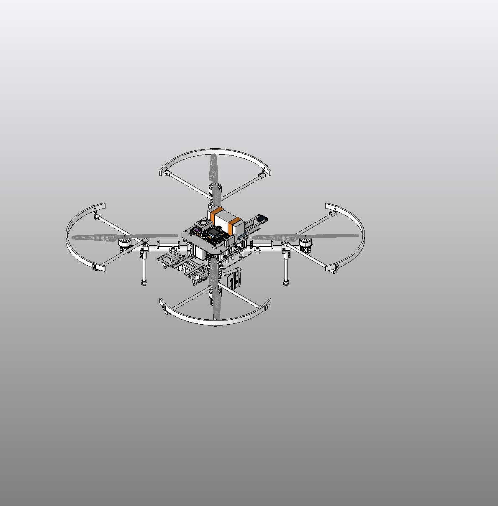
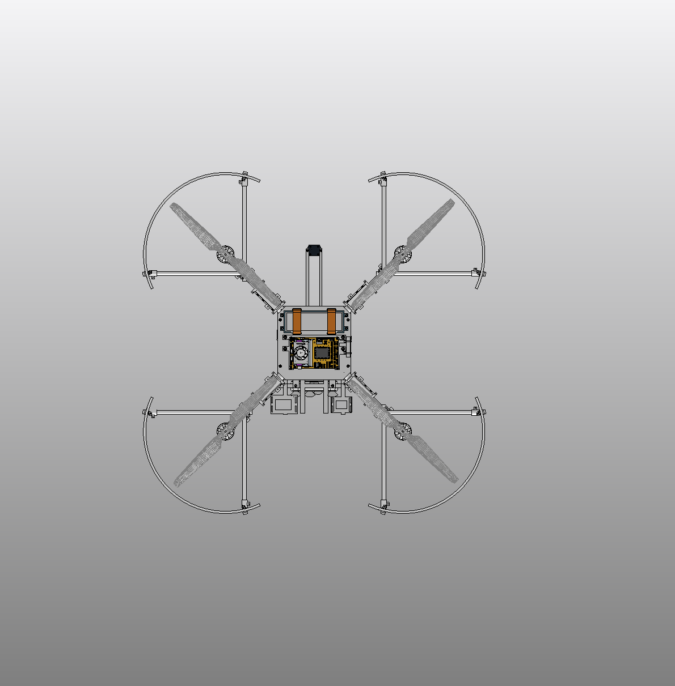
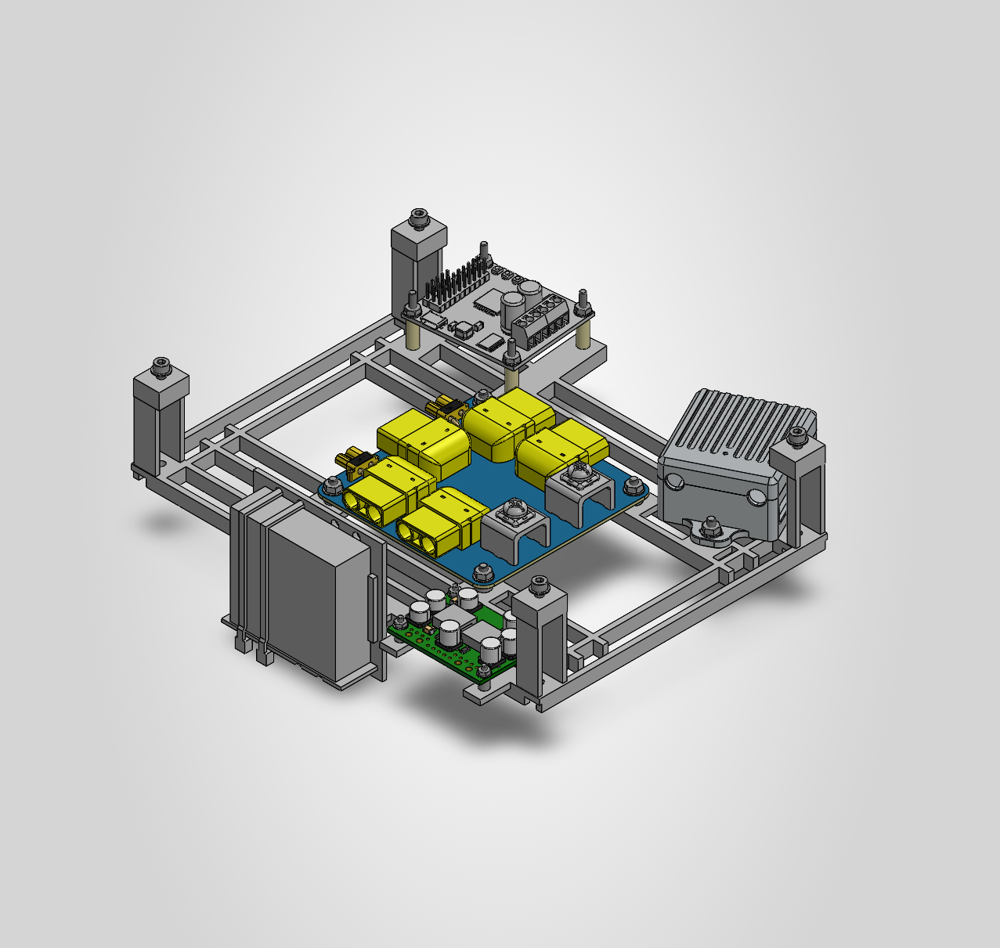

# C215 — internal PM08 packaging WIP

Current saved assembly: [DronePlayground.SLDASM](cad/DronePlayground/WORKING/R3_1/DronePlayground.SLDASM), configuration **R3_3_CENTRAL_POWER_WIP**. The same native assembly now locates the manufacturer PM08 case on existing internal mounts, with its existing ten-piece mounting kit. The older external case/carrier and obsolete USB-storage fallback are suppressed only in this configuration. The C180 radio-integration configuration remains available.

C215 reopened the saved assembly and checked 87 roots / 62 active roots, saved reference paths/configurations/poses, the PM08 module's 26 roots / 24 active roots, and zero errors on five new root mates and two module mates. A massless sketch contains 28 proposed lead-route segments. Scoped earlier case/hardware/lead-allocation checks covered the retained surrounding geometry; actual cable dimensions, terminations and service behavior remain to be qualified.

The NVMe body is a 42 × 22 × 2.23 mm catalogue/interface reference with a 5 g catalogue mass override. The combined E-key adapter/accelerator body is an approximate space allocation with a **30 g design allowance**, not verified manufacturer geometry or a proven card fit. Neither reservation demonstrates mating, retention, boot, PCIe or driver compatibility. Imported-compute model coverage and the merged socket/contact region remain unresolved.

The incomplete native representation is **3.2598 kg**, not a reconciled aircraft mass or flight CG. Missing hardware/wiring, assumed materials and design allowances remain. Arm roots, guards, motor axes, gripper, landing and flow sensor are unchanged in this checkpoint. External shelf removal and simpler arm interfaces are still being reviewed.

This is a version-control archive of an engineering WIP, **not a manufacturing or flight release**. Native bytes and existing relative archive paths are preserved. Cross-machine reference resolution and cold portable checkout remain unverified. Use Git LFS and `git lfs pull`; file sizes and hashes are recorded in the [checkpoint manifest](checkpoints/C215/manifest.json) and [current asset manifest](manifest.json). [C180 remains in history](https://github.com/rohanbhadange/RTX-AVC-Design/tree/abdcbf29504fcbe194f0bcb1597a6e0320edf69a).

## Saved native views

