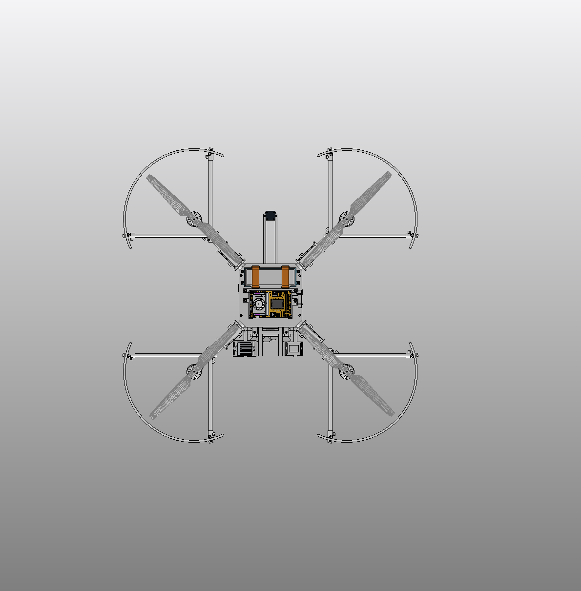
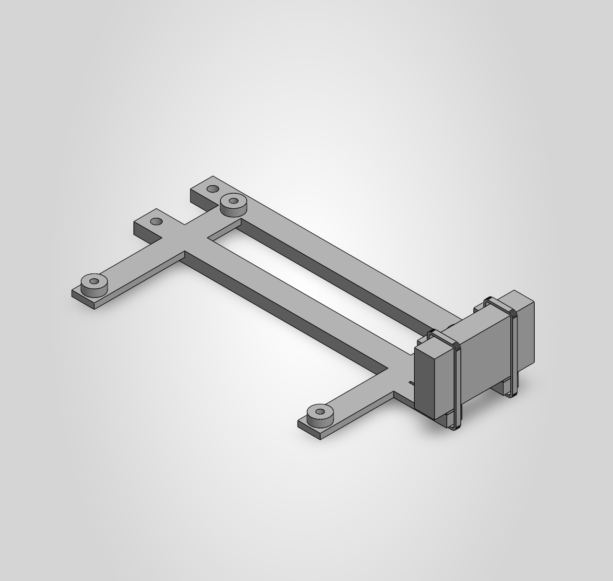

# C180 — SiK radio integration

Current saved assembly: [DronePlayground.SLDASM](cad/DronePlayground/WORKING/R3_1/DronePlayground.SLDASM), configuration **R3_3_RADIO_INTEGRATION**. C179 installed the compute/radio module in the existing main; C180 saved, reopened and exported the native views below. The prior packaging configuration is preserved.

One onboard Holybro SiK V3 100 mW catalog body is retained on an integral extension of the shared compute cradle, with protective-pad and tie-route approximations. It uses no separate bracket or mounting screws. The radio representation uses the catalog **23.5 g including the antenna once**; antenna geometry remains unmodeled. Added support, pads and ties contribute approximately **2.90 g at provisional assumed densities**. The incomplete native aircraft representation is about 3.232 kg; this is not a reconciled physical aircraft mass or flight CG result.

Scoped native checks reported clear body/support and end-service allocations. C180 reopened with 84 roots / 62 active roots, six module components, and zero errors on five module mates and three root mates. This evidence covers the saved installation and the checked allocations. Actual connector, antenna, cable, protective-pad and tie behavior remain approximated or unmodeled.

Actual USB host allocation, storage/boot behavior, RF performance, retention, printing, vibration and electrical integration remain open. Inherited frame/CAM warnings and remaining system-integration holds persist. This is an engineering prototype checkpoint, not a manufacturing or flight release. Locally authored CAD references are preserved; cross-machine reference resolution and cold portable checkout remain unverified.

The [nine-file checkpoint manifest](checkpoints/C180/manifest.json) records relative paths, sizes and SHA256 hashes. The [current asset manifest](manifest.json) retains unchanged baseline dependencies without duplicating CAD. Use Git LFS and `git lfs pull` to retrieve native files. The previous [C168 power-carrier checkpoint](https://github.com/rohanbhadange/RTX-AVC-Design/tree/6bf4cbe56adefc6e6fe75dc1f9d2995498c3d246) and [C124 baseline](https://github.com/rohanbhadange/RTX-AVC-Design/tree/33064c5ab7eba07455f86873217466ac426707c5) remain available in history.

## Native checkpoint views

The C178 detail below shows the saved compute/radio module subsequently installed in the main, including the catalog body and retention approximations.

