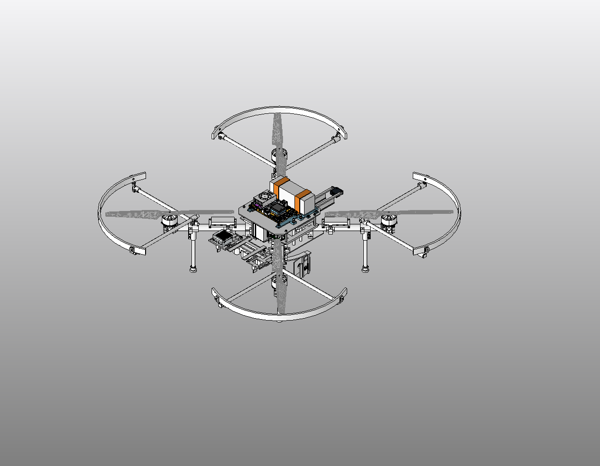
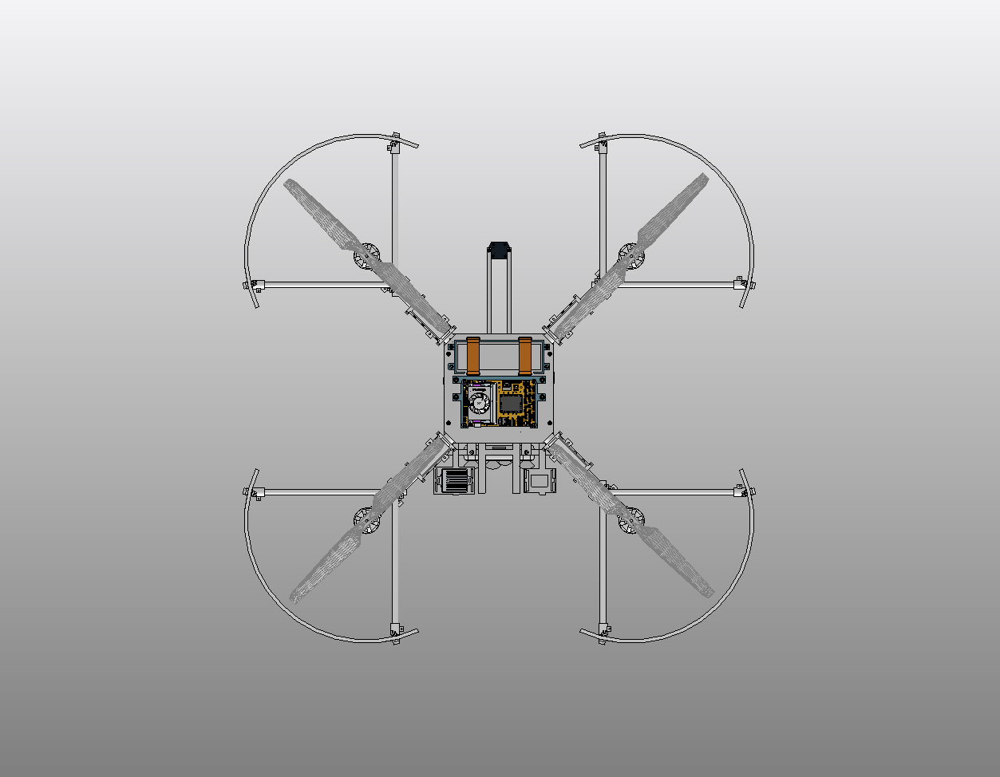

# RTX AVC — Design Control

Engineering design, electrical integration, and revision history for the RTX Autonomous Vehicle Challenge UAV.

## Wiring diagrams and versioned electrical documentation

- [W-100 and W-101 complete diagrams](diagrams/README.md) — native Wiring Studio PNGs, searchable SVG views, and pin-to-pin CSVs.
- [System wiring architecture](diagrams/architecture.md) — power, Jetson/BrainChip/SiK interfaces, and pilot safety/control paths.
- [Wiring publication policy](docs/wiring-maintenance.md) — changes to Wiring Studio must be accompanied by refreshed GitHub snapshots, screenshots, and change notes.
- [Current W-100 snapshot](snapshots/wiring-studio/W-100_current.json) and [W-101 snapshot](snapshots/wiring-studio/W-101_current.json). New snapshot commits automatically regenerate SVG/CSV through GitHub Actions.

Current saved CAD checkpoint: **[C180 — SiK radio integration](CURRENT_CAD.md)**, configuration `R3_3_RADIO_INTEGRATION`. The [C168 power-carrier checkpoint](https://github.com/rohanbhadange/RTX-AVC-Design/tree/6bf4cbe56adefc6e6fe75dc1f9d2995498c3d246) remains in the repository history. The previous C124 archive remains available in [its original commit](https://github.com/rohanbhadange/RTX-AVC-Design/tree/33064c5ab7eba07455f86873217466ac426707c5).

## Source of truth
- **Native CAD:** working SolidWorks assembly, with exported/reviewed releases committed when available. Do not infer CAD geometry from wiring diagrams.
- **Electrical:** Wiring Studio project `RTX AVC | R3.5 INTEGRATION SELECTED — engineering test HOLD`, W-100 (integrated wiring) and separate W-101 power-tree project. Wiring Studio is a live working model, *not* automatically synchronized to GitHub.
- **Decisions:** `docs/decisions/` contains date-stamped architecture decisions, alternatives, evidence, changes, and acceptance tests.
- **Validation:** passing a schematic check is not flight qualification. Record hardware/bench evidence before marking a design validated.

## Workflow
1. Inspect the latest physical/documentation baseline before changing interfaces.
2. Record the requirement, alternatives, and decision in a dated design note.
3. Change the smallest necessary parts of the live tool and preserve unrelated interfaces.
4. Compare connected-component counts, wiring nets, and design-rule checks before/after.
5. Commit a change record with the tested/unverified status. Use pull requests for larger revisions.
6. Attach exported drawings or CAD screenshots and update mass, connector, cable-length and packaging evidence as it becomes available.

## Current integration decisions
- [ADR-0001: SiK 915 MHz radio on Jetson USB](docs/decisions/ADR-0001-sik-jetson-usb.md) — replaces Pixhawk TELEM1 radio harness; keeps the R81 safety receiver separate.
- BrainChip AKD1000 B+M 2260 via Delock 64343 in Jetson E-key; SSD remains in the M-key socket (documented in the live W-100 component records).

> Design statuses are deliberately distinct: *proposed*, *schematic-integrated*, *mechanically packaged*, *bench-validated*, and *flight-validated*. Never promote a status without evidence.

## Historical C124 CAD archive — Drone Playground

Saved source checkpoint of the existing SolidWorks drone project: **C124 / R3_3_PACKAGING**. This repository records the integrated engineering baseline and its referenced CAD dependencies. No optimized candidate geometry is installed in this checkpoint.

The historical C124 assembly is [preserved in its original commit](https://github.com/rohanbhadange/RTX-AVC-Design/blob/33064c5ab7eba07455f86873217466ac426707c5/cad/DronePlayground/WORKING/R3_1/DronePlayground.SLDASM). CAD is stored with Git LFS. Install Git LFS before cloning, then run `git lfs pull` to download the actual CAD files.

Project directory relationships and native reference bytes are preserved. **Cross-machine path resolution and a cold portable checkout have not been verified.** This is a saved-source version-control archive. It is not a flight, fabrication or manufacturing release. Material densities and represented masses include provisional assumptions.

The saved baseline passed scoped save/rebuild checks with error/warning status 0/0 and 82 baseline root signatures preserved. The archive was copied from an explicitly reviewed dependency allowlist, with source/copy/source SHA256 agreement. [The C124 file manifest](https://github.com/rohanbhadange/RTX-AVC-Design/blob/33064c5ab7eba07455f86873217466ac426707c5/manifest.json) records archived asset paths, sizes and SHA256 hashes. These checks establish the recorded disk snapshot; they do not qualify mechanical loads, electrical safety, complete harness routing or aircraft performance.

See [checkpoint notes](CHECKPOINT.md) for implemented scope and remaining integration work, and [source attribution](ATTRIBUTION.md) for third-party CAD ownership.

### Historical native views

These C122 exports show the earlier C121 internal-power integration geometry inherited by C124. They do not show installed R3.3 optimization candidates.

