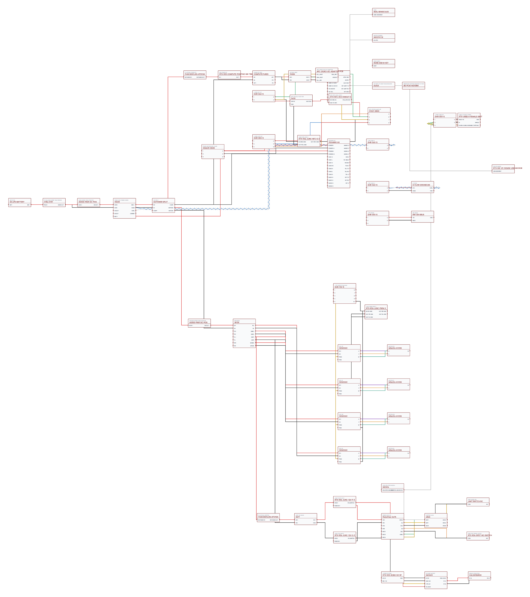
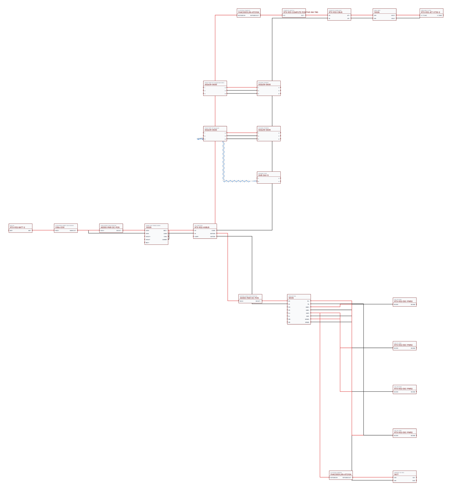

# Wiring diagrams — RTX AVC R3.5

**Last captured:** 2026-11-02  
**Source:** connected Wiring Studio, **W-100** integrated aircraft wiring and **W-101** dedicated power tree.  
**Engineering state:** schematic-integration / engineering test HOLD — **not released for fabrication or flight**.

## Native Wiring Studio diagrams

These PNGs were rendered from the live Wiring Studio model at the date above. The *design* views show routing/physical component placements; the *wiring* views show individual electrical connections. Images are not editable source files.

| Sheet | Wire-level schematic | Physical/design layout | Structured source |
| --- | --- | --- | --- |
| W-100: integrated vehicle | [Open W-100 wiring PNG](wiring-studio/W-100-wiring.png) | [Open W-100 design PNG](wiring-studio/W-100-design.png) | [W-100 current JSON](../snapshots/wiring-studio/W-100_current.json) |
| W-101: main, compute and motion power | [Open W-101 wiring PNG](wiring-studio/W-101-wiring.png) | [Open W-101 design PNG](wiring-studio/W-101-design.png) | [W-101 current JSON](../snapshots/wiring-studio/W-101_current.json) |

### W-100: complete wiring schematic

### W-101: power distribution schematic

## Easier-to-read / searchable views

- [Electrical architecture with Mermaid diagrams](architecture.md) — power, compute and communications, propulsion, and gripper protection, with caveats.
- [W-100 autogenerated wiring SVG](generated/W-100-wiring.svg) / [design SVG](generated/W-100-design.svg) / [pin-to-pin CSV](generated/W-100-netlist.csv).
- [W-101 autogenerated wiring SVG](generated/W-101-wiring.svg) / [design SVG](generated/W-101-design.svg) / [pin-to-pin CSV](generated/W-101-netlist.csv).

Generated SVG and CSV files are derived from the committed `W-100_current.json` and `W-101_current.json` snapshots, not manually maintained. They preserve logical model component connectivity; the original Wiring Studio PNGs are still the best visual reference for the native schematic.

> **Important:** W-101 is a separate breakdown of W-100's power tree, not a second set of batteries, PM08 modules, or PDBs. Do not add the two BOMs together. Some logical boxes in the model are junctions, not separately purchased physical parts.

## Revision discipline

See [wiring maintenance and publishing procedure](../docs/wiring-maintenance.md). **Every wiring design change should publish the updated current JSON snapshots, native images, generated diagrams/netlists, and change log together.** GitHub Actions can regenerate the SVG/CSV whenever a current snapshot changes in GitHub. **It cannot see uncommitted edits in Wiring Studio; the live model must be exported/committed first.**

The current models have unmeasured cable lengths and incomplete connector terminations; do not use these diagrams as manufacturing harness prints.
