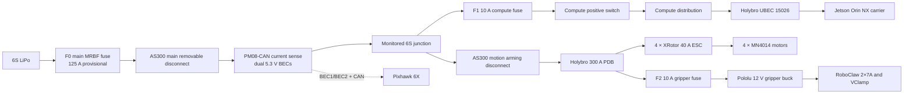
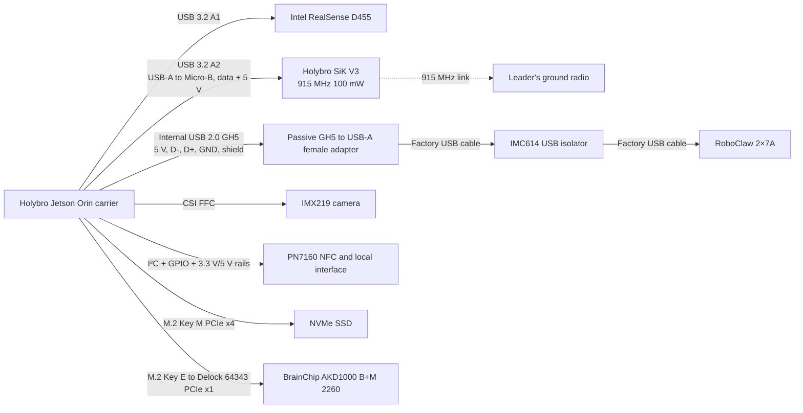
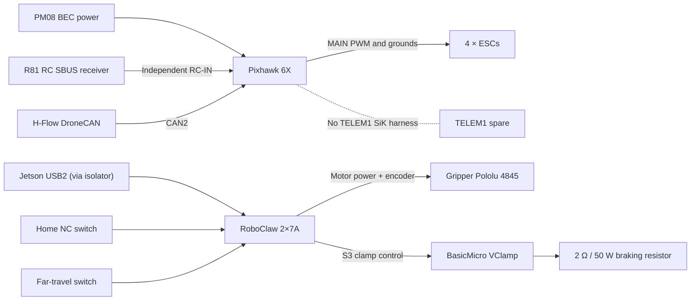

# RTX AVC R3.5 — electrical architecture

**Based on:** live Wiring Studio W-100 integrated wiring and W-101 power tree, captured 2026-11-02.  
**Status:** schematic-integrated, engineering test HOLD.

This page is a **functional block-diagram companion** to the pin-level/native schematics in [Wiring diagrams](README.md). It is deliberately simplified: a line may represent a cable assembly, integrated connector, or a bus with multiple wires. **Do not wire the aircraft from this page alone.**

## 1. Main power distribution

The Pixhawk and compute subsystems are powered independently of the motion arming plug. Fuse values and terminations are provisional in the live model. W-101 is the power-tree detail, not an additional physical PDB.

## 2. Jetson interfaces and communications

**SiK change:** The onboard SiK receives all power/data via one Jetson USB cable, not Pixhawk TELEM1. Holybro identifies **Micro-USB on the V3 100 mW** model; the 1 W model uses USB-C. The team requirement of USB-C is overridden by the actual selected 100 mW product specification unless a different purchased revision is confirmed. Keep antenna accessible, clear of the carbon structure, and adjustable for arena-range testing.

## 3. Flight-control and gripper safety interfaces

**Safety:** The R81-to-Pixhawk connection remains the pilot override/kill path independent of the Jetson/SiK communications link. This diagram represents the present RoboClaw controller in W-100, not a completed transition to the proposed Pico 2 / DRV8874 controller.

## Validation and tracing

- See [ADR-0001](../docs/decisions/ADR-0001-sik-jetson-usb.md) and [SiK USB change record](../docs/changes/2026-11-02-sik-usb.md).
- Refer to [W-100 pin-level netlist CSV](generated/W-100-netlist.csv) and [W-101 power netlist CSV](generated/W-101-netlist.csv) for exact modeled endpoints.
- Refer to [the native Wiring Studio PNGs](README.md) for routing and physical locations.
- Do not treat current status as bench/flight validation. Unassigned harness lengths, contact sizes, and physical mounting details remain incomplete.
